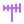
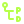
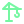
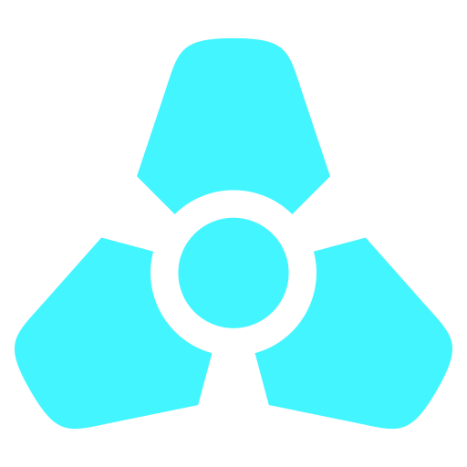
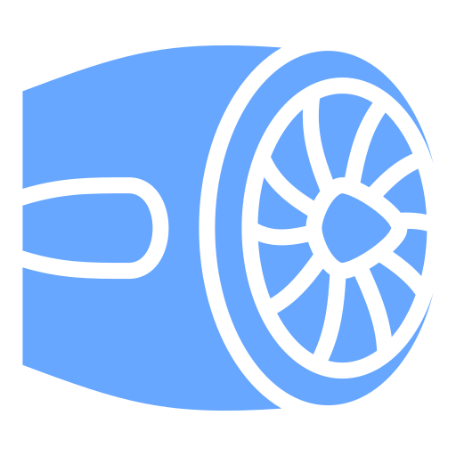

  

<h3 align="center">LANGUAGES</h3>

  

  
  
  
  
  
  

<h3 align="center">FRAMEWORKS & RUNTIMES</h3>

  

<h3 align="center">TOOLS & PLATFORMS</h3>

  

  
  
  
  
  
  
  
  
  
  
  
  
  
  
  

<h3 align="center">HARDWARE</h3>

  
  
  
  
  
  
  
  
  
  
  
  
  
  
  
  
  
  
  
  
  
  
  
  
  
  
  
  
  
  
  
  
  
  
  
  
  
  
  
  
  
  
  
  

<h3 align="center">OPERATING SYSTEMS</h3>

  
  
  
  
  
  
  
  
  
  
  
  
  
  
  
  
  
  
  
  
  
  
  
  
  
  
  
  
  
  
  
  
  
  
  
  
  
  
  
  
  
  

<h3 align="center">AI / ML</h3>

  
  
  
  
  
  
  
  
  
  
  
  
  
  
  
  
  
  
  
  
  
  
  
  
  
  
  
  
  
  

<h3 align="center">ENGINEERING</h3>

  
  
  
  
  
  
  
  
  
  
  
  
  
  
  
  
  
  
  
  
  
  
  
  
  
  
  
  
  
  
  
  
  
  
  
  
  
  
  
  
  
  
  
  
  
  
  
  
  
  

