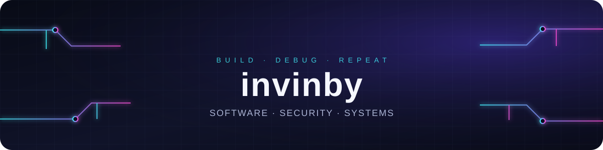

  

<h3 align="center">LANGUAGES</h3>

  

<h3 align="center">FRAMEWORKS &amp; RUNTIMES</h3>

  

<h3 align="center">TOOLS &amp; PLATFORMS</h3>

  

<h3 align="center">APPLE · MACINTOSH · CLASSIC HARDWARE</h3>

  
  
  
  
  
  
  
  
  
  
  
  
  
  
  

<h3 align="center">UNIX &amp; LINUX SIDE QUESTS</h3>

  
  
  
  
  
  
  
  
  
  
  
  
  
  
  
  
  
  
  
  
  
  

<h3 align="center">НЕОЖИДАННАЯ ТЕХНОПОЛКА</h3>

<h4 align="center">ОС, UNIX И ЦИФРОВАЯ ПРИВАТНОСТЬ</h4>

<table align="center"><tbody>

<tr>
    <td align="center" width="25%"> ReactOS Windows-подобная ОС</td>
    <td align="center" width="25%"> Qubes OS изоляция приложений</td>
    <td align="center" width="25%"> OpenWrt прошивка роутеров</td>
    <td align="center" width="25%"> EndeavourOS Linux на базе Arch</td>
  </tr>

<tr>
    <td align="center" width="25%"> Slackware классический Linux</td>
    <td align="center" width="25%"> Tails приватная live-ОС</td>
    <td align="center" width="25%"> Tor Project анонимная сеть</td>
    <td align="center" width="25%"> GNU свободная система</td>
  </tr>

</tbody></table>

<h4 align="center">ЖЕЛЕЗО, ПРОШИВКИ И ЭМУЛЯЦИЯ</h4>

<table align="center"><tbody>

<tr>
    <td align="center" width="25%"> Coreboot открытая прошивка</td>
    <td align="center" width="25%"> QEMU эмуляция и виртуалки</td>
    <td align="center" width="25%"> VirtualBox виртуальные машины</td>
    <td align="center" width="25%"> VMware виртуализация</td>
  </tr>

<tr>
    <td align="center" width="25%"> Espressif чипы ESP</td>
    <td align="center" width="25%"> MicroPython Python для микроконтроллеров</td>
    <td align="center" width="25%"> ESPHome умный дом на ESP</td>
    <td align="center" width="25%"> PlatformIO разработка для устройств</td>
  </tr>

<tr>
    <td align="center" width="25%"> OctoPrint управление 3D-принтером</td>
    <td align="center" width="25%"> Home Assistant умный дом</td>
    <td align="center" width="25%"> openHAB автоматизация дома</td>
    <td width="25%"></td>
  </tr>

</tbody></table>

<h4 align="center">ЯЗЫКИ ИЗ ДРУГОГО ИЗМЕРЕНИЯ</h4>

<table align="center"><tbody>

<tr>
    <td align="center" width="25%"> Ada язык для критических систем</td>
    <td align="center" width="25%"> Erlang распределённые системы</td>
    <td align="center" width="25%"> Elixir язык на BEAM</td>
    <td align="center" width="25%"> Common Lisp семейство Lisp</td>
  </tr>

<tr>
    <td align="center" width="25%"> Wolfram символьные вычисления</td>
    <td align="center" width="25%"> Julia численные вычисления</td>
    <td width="25%"></td>
    <td width="25%"></td>
  </tr>

</tbody></table>

<h4 align="center">СТРАННЫЕ УГОЛКИ ИНТЕРНЕТА</h4>

<table align="center"><tbody>

<tr>
    <td align="center" width="25%"> Mastodon децентрализованные соцсети</td>
    <td align="center" width="25%"> Matrix открытая сеть общения</td>
    <td align="center" width="25%"> Signal приватный мессенджер</td>
    <td align="center" width="25%"> Element клиент Matrix</td>
  </tr>

<tr>
    <td align="center" width="25%"> XMPP открытый протокол чатов</td>
    <td align="center" width="25%"> ActivityPub протокол соцсетей</td>
    <td align="center" width="25%"> Syncthing синхронизация без облака</td>
    <td align="center" width="25%"> WireGuard современный VPN</td>
  </tr>

<tr>
    <td align="center" width="25%"> OpenVPN VPN-протокол</td>
    <td align="center" width="25%"> OpenStreetMap карта от сообщества</td>
    <td align="center" width="25%"> Wikipedia свободная энциклопедия</td>
    <td align="center" width="25%"> Internet Archive цифровая библиотека</td>
  </tr>

<tr>
    <td align="center" width="25%"> Archive of Our Own архив фанатских историй</td>
    <td width="25%"></td>
    <td width="25%"></td>
    <td width="25%"></td>
  </tr>

</tbody></table>

<h4 align="center">ТЕРМИНАЛЬНАЯ КЛАССИКА</h4>

<table align="center"><tbody>

<tr>
    <td align="center" width="25%"> Vim редактор для терминала</td>
    <td width="25%"></td>
    <td width="25%"></td>
    <td width="25%"></td>
  </tr>

</tbody></table>

<h3 align="center">AI · NEURAL NETWORKS · DATA</h3>

  
  
  

